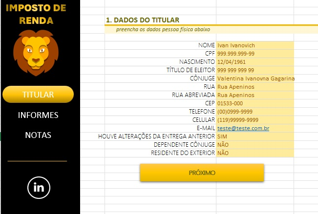

# Organizador de dados para Imposto de Renda no Excel

Desafio Criando uma Ferramenta de Controle de Investimentos com Excel do bootcamp **"Reclame AQUI - Dados e IA na Prática"**, feito pela [Digital Innovation One ](https://www.dio.me/).

---

## Sobre o desafio

Esta planilha Excel o objetivo de organizar e validar as informações financeiras e cadastrais necessárias para a Declaração do Imposto de Renda Pessoa Física.

## Estrutura

O arquivo possui 3 planilhas e uma tabela auxiliar.

1. **`TITULAR` :**
   * Coleta e organização de dados pessoais do contribuinte.
2. **`INFORMES`:**
   * Registro de saldos em instituições financeiras.
3. **`NOTAS`:**
   * Tabela de entradas financeiras para controle e categorização de receitas mensais.
4. **`APOIO`:**
   * Listagem padronizada das instituições bancárias do Brasil.

